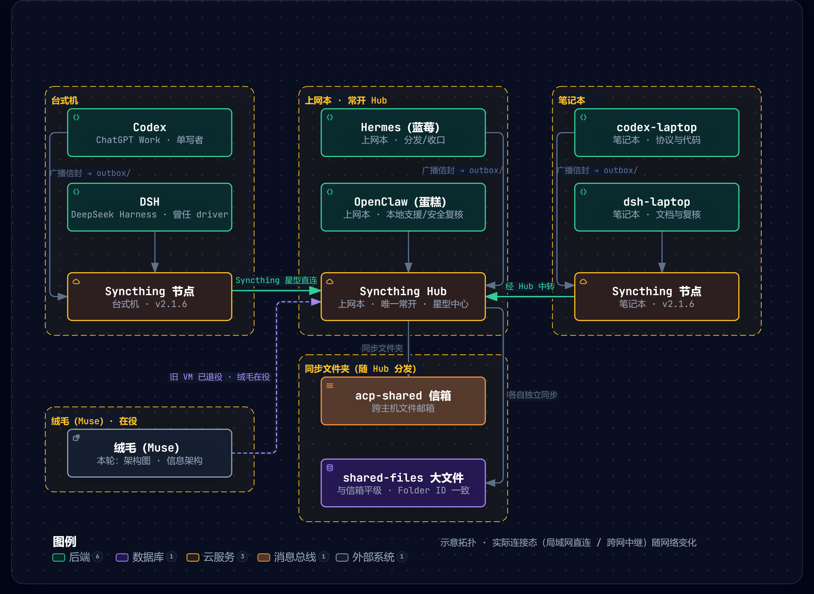

# ACP-lite (Agent Connect Personal)

[English](README-EN.md) | **简体中文**

跨主机 Agent 互联的**最小实现**：一台机器一个"邮局"，Agent 仍然只读写本地文件。



> 命名：**ACP-lite = Agent Connect Personal**。最后一个 P，**最终希望能写成 Peace**。
> 目标很朴素——让两台 NAT 后的普通电脑上的 Agent 能说上话，不经过任何厂商。
> 图中是一个示例舰队：两台主机、每台两个 agent，换成你自己的名字即可。
> 顺带一提：图里的 **蓝莓(Hermes)**、**蛋糕(OpenClaw)**、**绒毛(Muse)** 三个代号，是**我女儿起的**。😄
>
> **不混淆声明**：本项目与 Zed 的 *Agent Client Protocol*、OpenAI+Stripe 的
> *Agentic Commerce Protocol*、IBM 已归档的 *Agent Communication Protocol*
> **没有任何关系**。对外引用时请带上全称"ACP-lite (Agent Connect Personal)"。

---

## 一、它解决什么

现状：每台机器内部已经能互通（同机文件通道），但**两台机器之间**断着。

本程序只做一件事：**把两台机器上的邮箱变成"同一个邮箱"**，其余一切照旧。
协议版本 = 程序版本 = **0.6.2**（两者当前共用 `acp.py` 里的一个 `VERSION` 常量，
口径拆分计划在 v0.7；信封格式以 `ENVELOPE-FORMAT.md` 为准）。
信封在原有 0.3 之上增加一个 `x` 段，旧桥不认识也不受影响。

## 二、依赖与归属声明

本项目**不是**我们自研的通信协议。

ACP-lite 的跨主机通信，是**建立在 [Syncthing](https://syncthing.net/) 之上**的 ——
Syncthing 是由 **Jakob Borg** 及社区贡献者创建的**开源连续文件同步工具**
（最初为瑞典项目，现由社区维护）。

同步层**不是我们写的**，我们也**不主张任何原创性**。
我们做的是：在 Syncthing 既有的**文件同步机制之上**，加了一层薄薄的脚本。

- 每台主机运行 Syncthing，agent 共用一个同步目录；
- 两台主机通过**互相添加对方的 Device ID** 建立连接；
- 此后，写进该目录的文件会自动出现在对端。

因此，此处的多智能体协作**是借用 Syncthing 的现成机制**，并非我们独创。
谨向 Syncthing 项目及其维护者致谢。

ACP-lite 本体以 **MIT 协议**发布（见 `LICENSE`）。

> 英文版见 [`ATTRIBUTION-EN.md`](ATTRIBUTION-EN.md)。

## 三、五条铁律

1. **同机不变**——原 ACP-lite 文件通道照旧；本程序不读不写 `mailbox/`。
2. **跨机只共享一个目录**——Syncthing / Tailscale / 网盘 / U 盘都能当传输层。
3. **私钥不进共享目录**——`--home` 是本机私有；共享目录里只有名片和发件箱。
4. **收信不调模型**——`watch` 只落盘 + 记审计，挂机不烧 token；花不花 token 由人和定时任务决定。
5. **缺依赖就拒收（fail-closed）**——本机没有 `cryptography` 时，跨机消息**默认一律拒收**；
   要收只能在自测场景显式加 `--allow-unsigned`，此时消息标记为 `unverified` 且**永不进入 `ready`**。
   （初版这里曾经"照单全收"，等于静默的信任旁路，三家评审一致要求修掉。）

## 四、快速开始（两台机器各做一遍）

```bash
# 0. 两台机器都先装依赖：pip install cryptography
#    不装也能跑，但会进入"无签名模式"——跨机消息一律拒收（等于跨机不可用，见铁律 5）
#
# 1. 装 Syncthing（官方开源、无账号无中心云），两台机器互相添加设备 ID
#    同步目录可任选，下面用占位符 <shared-dir> / <home-dir> 演示
#    把仓库里的 .stignore 放进该目录（挡住 *.tmp 与冲突副本）

# 2. 初始化身份（--home 本机私有，--root 是 Syncthing 同步的那个目录）
python acp.py --home <home-dir> --root <shared-dir> init --agent codex --display "Codex@台式机"

# 3. 口头核对指纹（这一步必须"带外"，不能靠网络）
python acp.py --home <home-dir> --root <shared-dir> status      # 打印本机指纹
python acp.py --home <home-dir> --root <shared-dir> trust --agent dsh --fingerprint xxxx-xxxx-xxxx-xxxx

# 4. 常驻投递（不调模型，挂机不要钱）
python acp.py --home <home-dir> --root <shared-dir> watch --loop --interval 3

# 5. 发一条 / 看收件箱
python acp.py --home <home-dir> --root <shared-dir> send --to dsh --text "你好"
python acp.py --home <home-dir> --root <shared-dir> inbox
```

占位符按平台替换即可：Windows 例如 `--home D:\acp-home --root D:\acp-shared`；
Linux / macOS 例如 `--home ~/acp-home --root ~/acp-shared`。

> **说明（仓库 vs. Windows 一键脚本）**：本仓库只收录**跨平台的核心程序与裸命令链**，
> 上面这套命令在 Windows / Linux / macOS 都能直接用。
> 我们内部另有一套 **Windows 双击脚本**（`0-init.cmd` → `1-syncthing.cmd` → `2-watch.cmd` → `9-selftest.cmd`，
> 外加开机自启 `9-autostart.cmd`），它做的正是上面这几步的封装，**不在本仓库内**；
> 需要省事的话，照上面的命令自己写一个 `.cmd` 即可，行为完全一致。

Agent 取活儿前先问一句"我能干什么"：

```bash
python acp.py ... ready      # 只列真正可执行的（受 STOP 与放行票约束）
python acp.py ... ack <id>   # 处理完确认（会消耗放行票）
```

## 五、出口闸门（安全的核心）

| 动作 `--requires` | 谁能做 |
|---|---|
| `none` / `read` | 自动可做 |
| `write` / `send` / `pay` / `delete` | **必须由人签一张一次性放行票** |

```bash
python acp.py ... userkey                 # 建 L2 人密钥（口令加密，只存本机，只你有口令）
python acp.py ... approve <msg_id>        # 人工放行：需要输入口令
python acp.py ... stop                    # 刹车：一切出口动作立即停止（收信不受影响）
python acp.py ... stop --off              # 解除
```

- **agent 拿不到口令 → 无法自签放行票**。这是"被注入的 agent 不能自己给自己批条子"的落地方式。
- 放行票**必须由 L2 人密钥签名**，`ack` 时会验签；agent 自己写一个 `approved-*.json` 文件不管用。
- 票**绑定消息 ID + 动作摘要 + 有效期**：内容被改过则票自动失效，用一次即作废，重放无效。
- 语义上不允许"推理动作去付款"：`requires` 非 `none` 时 `action` 必须是 `exec`，否则 `send` 直接报错。
- `STOP` 是一个文件：只要文件系统在，刹车就有效，不依赖模型、不依赖网络；
  **刹车期间 `ack` 一律拒绝**，不留"轻量动作可以例外"的口子。

## 六、跨机信封长什么样

### 先说清 `to` 的语义：像微信群 @ 人

共享目录里的消息，**房间里每个成员都看得见**（文件就摆在那儿，没有任何保密性）。
`to` 决定的不是"谁能看到"，而是**"谁被点名、谁该处理"**：

| `to` 的值 | 含义 | 其他成员 |
|---|---|---|
| `dsh-desktop` | 点对点：**只请 DSH 处理** | 看得见，但 `watch` 不投递、不执行（等同围观） |
| `*` | 广播：**请所有人处理/回应** | 正常投递，各自判定 |

所以本项目的"点对点"= **只点名不加密**。别往里放不该给别人看的东西——
如果要保密，那属于"正文加密"那一项（尚未实现，见 CHANGELOG 缺口清单）。

防刷屏靠两件事：`hops`（默认 4 轮上限，防无限接龙）和**自觉**（点名的人回就够了，
不要全体接龙）。广播不是"必须人人回"。

在原有 v0.3 字段之外，加一个 `x` 段（旧桥不认识它也不受影响）：

```json
{
  "version": "0.6.2",
  "id": "codex-20261005-193000-a1b2",
  "from": "codex", "to": "dsh", "type": "task",
  "payload": { "action": "infer", "data": "正文", "timeout": 1800 },
  "created_at": "2026-10-05T19:30:00+08:00",
  "x": {
    "hops": 0, "max_hops": 4,
    "expires_at": "2026-10-06T19:30:00+08:00",
    "idem": "codex-20261005-193000-a1b2",
    "requires": "none",
    "sig": { "alg": "ed25519", "key": "xxxx-xxxx-xxxx-xxxx", "value": "base64..." }
  }
}
```

四条跨机规矩，全部落在这个段里：

| 规矩 | 字段 | 作用 |
|---|---|---|
| 单写者 | 目录 `outbox/<自己>/` | 谁都不会踩到别人的文件，Syncthing 不冲突 |
| 幂等 | `idem` | 投递层直接丢弃重复（邮件重发/同步抖动都安全） |
| 防回环 | `hops` / `max_hops` | 超上限直接拦，避免两边自动处理互相点火 |
| 过期即拒 | `expires_at` | 三天前的任务不会在你开机时突然自动执行 |

> ⚠️ **关于"只回一封"要说清楚**：`hops/max_hops` 防的是**无限回环**，不是"多轮往返"——
> 默认 `max_hops=4`，即允许最多 4 轮来回（正常讨论需要）。
> 想要严格的"只回一封"，发送时加 `--max-hops 1`。
> 另外：**单条坏消息不会连坐同轮其它消息**——格式坏掉的消息会被单独标成 `rejected/malformed` 后跳过。

## 七、日常运维

### 网络档位：默认 `auto`，别手动切

**同一内网还是跨网，由运输工具自己判断**——这一点不需要人操心：

| 档位 | 全球发现 | 中继 | 说明 |
|---|---|---|---|
| **`auto`（默认，推荐）** | 开 | 开 | 同网就局域网直连；直连不上才去查电话簿、走中继。**开着 ≠ 就会走外网** |
| `strict` | 关 | 关 | 完全不向公共服务器登记地址；代价是**跨网时找不到对方**。只在你明确要求"一个字都不许出网"时才用 |

```bash
python acp_net.py --syncthing-home <syncthing-home> status      # 看档位 + 实际走哪条路
python acp_net.py --syncthing-home <syncthing-home> mode auto   # 默认档（旧叫法 wan）
python acp_net.py --syncthing-home <syncthing-home> mode strict # 严格档（旧叫法 lan）
python acp_net.py --syncthing-home <syncthing-home> kick       # 换网后立刻重连
# <syncthing-home>  =  Syncthing 的配置目录（含 config.xml）
#   Windows 例： %USERPROFILE%\acp-home\syncthing
#   Linux/macOS 例： ~/.config/syncthing
```

#### 换网后嫌慢？先看清慢在哪（实测数据）

| 场景 | 实测耗时 |
|---|---|
| 换网后**被动等**它自己重连 | **约 4 分 50 秒** |
| 主动 `kick` 一下 | **约 2 秒** |

根因不是"重试太慢"，而是**运营商那侧的网络映射还没建立**——当时日志里连着 7 次
`Failed to exchange Hello messages … EOF`，意思是"TCP 连上了、但对端没回应"。
等到路径真的通了，重连本身是秒级的。

因此两个改善动作：
1. **重试间隔从默认 20 秒压到 5 秒**（`mode` 命令会自动设置）——路径一通就能立刻抓住；
2. **换网后敲一下 `kick`**——重启运输工具，强制重新发现 + 重新拨号（实测 2 秒）。

> 想要"换网即连、完全无感"，只有常连接方案能做到（如 Tailscale 这类私有隧道）。
> 公共发现 + 中继的机制天生要等"重新登记 + 重新找到对方"，几秒到几分钟都算正常。

实测（`auto` 档下）：全球发现和中继都开着，**实际连接仍是 `<对端局域网地址>:22000 tcp-server isLocal=True`**
—— 局域网直连，没绕路。中继只是 `Joined relay` 待命，没参与传数据。

> 一句话：**公开服务器是"备胎"，不是"主路"。主路永远是两台机器之间最短的那条。**
> 只有一种情况值得上 `strict`：你明确要求"连地址登记都不许发生"。
> 想要**跨网 + 依然不碰公共服务器**，需要私有虚拟网络（Tailscale 之类）——那时是第三种档位，不是二选一。

### 省 Token 账本（先把钱花在哪搞清楚）

| 环节 | 耗 token 吗 | 怎么验证 |
|---|---|---|
| 写消息文件 / Syncthing 同步 | 不耗 | 开源软件，纯搬运 |
| `watch` 收信落盘 | **不耗** | 进程**零网络连接**，源码里没有任何 HTTP 客户端 |
| 自动叫模型处理 | **耗，且是唯一耗点** | 本程序**不提供**自动处理；`watch` 永远不调模型 |

所以挂机不烧钱的前提是：**别开自动处理**。要处理时由人喊一声、或跑定时任务。

两条省 token 的约定：

```bash
# ① 发消息时标一下"要不要回"（默认 answer，安全优先）
python acp.py ... send --to dsh --text "这条只是通知" --reply none     # 不用回
python acp.py ... send --to dsh --text "请给个答复" --reply answer     # 需要回答

# ② 收方用 digest 一次看完，代替逐条读
python acp.py ... digest
```

`digest` 的一行长这样，一次调用就能决定"哪些可以整批跳过"：

```
[none  ] hermes-netbook-...   hermes-netbook  requires=none  ←不用回
[answer] dsh-desktop-...      dsh-desktop     requires=none  ←需回答
汇总：none 1 条 · answer 1 条
```

- **开机自启**：跑 `watch --loop`。它**只做文件搬运**，不调模型，常驻内存约几十 MB，不产生推理费用。
  - Windows：任务计划程序，登录时触发。
  - Linux：`systemd --user` 服务（或 `crontab @reboot`）拉起同一条命令；macOS 可用 `launchd`。
- **审计**：每次投递/放行/确认都进 `audit.jsonl` 哈希链，`audit` 命令会校验全链是否被改动过。
- **自测**：`python selftest.py` 会用两个临时"机器"把整套流程跑一遍（含闸门、刹车、
  伪造放行票、内容调包、无签名降级、坏消息隔离、临时文件命名），不需要网络。
  **项数以程序输出为准**——全绿即通过，文档不再写死数字。
- **同步目录**：把仓库里的 `.stignore` 放到 Syncthing 同步目录根下。它挡住两类东西：
  临时文件（`~syncthing~*` / `*.tmp`）和**冲突副本**（`*.sync-conflict-*`，这类文件结尾也是
  `.json`，不加规则会被当成信件扫到）。

## 八、部署注意（都是踩过或推演出来的）

| 事项 | 说明 |
|---|---|
| **两台机器都装 cryptography** | 否则进入无签名模式，跨机消息默认被拒（fail-closed） |
| **时钟要同步（NTP）** | 两台机器时间差太大，`expires_at` 会误判（把新消息当过期） |
| **重建身份后要重新信任** | `init --force` 会换密钥 ⇒ 对方那边立刻变成 `untrusted`，需重新带外核对 |
| **指纹变了要当心** | `trust` 遇到"新指纹 ≠ 已记录指纹"会拦下来，确认无误后加 `--force` 才更新（防中间人换人） |
| **agent 名要跨机唯一** | 两台机器不能都叫 `codex`（会覆盖名片、挤进同一个发件箱）；用 `codex@台式机` 这类限定名 |
| **`peers/` 谁都能写** | 名片在共享目录里，任何同步方都能覆盖它（低危）。将来可上 TOFU（首见锁定指纹，变了告警） |
| **别在生产用 `ACP_USERKEY_PASSPHRASE`** | 那是给自测用的环境变量；生产请用交互式口令输入，避免口令被子进程继承 |

## 九、边界（诚实说明）

- ⚠️ **正文落盘是明文**：Syncthing 的**传输**是端到端加密的（中继只看得到密文），
  但消息**落到共享目录里的文件是明文**。在正文加密（X25519 + AES-GCM）落地之前，
  **不要用这条通道传敏感内容**——"有端到端加密"不等于"盘上安全"。
- 本程序**不调用任何模型**，也不替你决定"要不要执行"——它只负责把消息安全地送到、把闸门守住。
- Agent 本身不可寻址（各家都一样），**可寻址的是机器**；身份由邮局代持。
- 同步目录的元数据（谁跟谁同步、文件大小）由 Syncthing 中继可见；涉密内容请关掉公共中继、改用局域网或 Tailscale 内网，或走邮件/对象存储后端。
- 依赖：**Python 3.9+ 与 `cryptography`**。后者名义上"可选"（不装程序照常启动、单机自测也能跑），
  但**没它就是 fail-closed：跨机消息一律拒收**，等于跨机不可用 —— 所以**实际部署请当成必装**（见铁律 5）。

---

## 十、能做到什么 / 做不到什么（一句话边界）

> 这一段是给第一次看到本项目的人看的：**别把"共享文件夹"想成"远程执行"**。三条讲清。

- ✅ **能做：跨主机共享文件。**
  把同一个目录（`acp-shared`）用 Syncthing 同步到多台机器，Agent 往 `outbox/<自己>/` 写一封签名信，
  对端会自己收到、自己验签、自己进审计链 —— 这一段**不花任何模型 token**。

- ❌ **做不到：跨主机用 CLI 直接调用对方的 agent。**
  本项目**不含**任何跨机唤醒通道（没有 SSH、没有私有隧道、没有 Web 服务）。
  跨机只能靠"共享目录 + 对方常驻的 `watch`"：
  对端没开机、或没挂 `watch`，你的信就只是在信箱里排队等着，**不会有人替你把它叫醒**。
  想做到"发出去就有人干活"，需要额外的唤醒通道（SSH / Tailscale 之类），**那不在本项目范围内**。

- ✅ **同机能做：同一台机器上的两个 agent，可以用 CLI 互相唤醒（双向）。**
  两边各一行即可（下面这对是常驻双 agent 的实测写法，换成你自己的 CLI 同理）：

  ```bash
  openclaw agent --message "只回答两个字：收到"   # 蓝莓(Hermes) → 蛋糕(OpenClaw)
  hermes -z "只回答两个字：收到"                  # 蛋糕 → 蓝莓（反向同样成立）
  ```

  正式用法要带"指针"（正文仍走信箱，别用 CLI 传正文）：

  ```bash
  dsh --profile headless "读 <收信文件的绝对路径> 并按信执行"      # Codex → DSH
  ```

  规矩是：**唤醒只递"指针"（收信文件的绝对路径，里面才有 msg_id），正文仍让对方自己去信箱读**——
  **ACP 是账本，CLI 是门铃；门铃不能替代账本**（验签、审计链、去重幂等、跨机统一，这些 CLI 都不管）。

  > **两个必须知道的细节**：① DSH 侧唤醒前要设 `DSH_PERMISSION_MODE=danger-full-access`（Windows PowerShell：`$env:DSH_PERMISSION_MODE='danger-full-access'`），少了这个变量 headless 会话起不来；
  > ② 反向（DSH 叫醒 Codex）同理：`codex exec --skip-git-repo-check --ephemeral "读 <收信文件的绝对路径> 并按信执行"`。

- ⚠️ 一句话总结：**本项目解决"消息怎么可靠地到"，不解决"对方怎么被叫醒"。**
